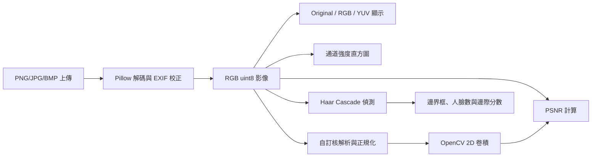

# 互動式影像處理與人臉分析工具報告

## Chapter 1：專案概述與環境建置

### 專案概述

本專案以 Python 與 Streamlit 建立互動式影像分析 Web App，提供影像上傳、RGB/YUV 通道與直方圖檢視、自訂卷積濾波、PSNR 評估及 Haar Cascade 人臉偵測。應用程式入口為 `main.py`。

### 開發環境與相依套件

- Python：建議 3.9 以上。
- 安裝套件：`python -m pip install -r requirements.txt`
- 啟動程式：`streamlit run main.py`
- 本次實測環境：Python 3.13.0、Streamlit 1.65.0、NumPy 1.26.4、OpenCV 4.11.0、Pillow 11.3.0、Matplotlib 3.10.9。
- 執行自動化測試：`py -m unittest discover -s tests`

| requirements.txt 條目 | 用途 |
|---|---|
| `streamlit` | Web 介面、上傳元件及互動控制 |
| `numpy` | 影像陣列、通道統計與 PSNR 計算 |
| `opencv-python-headless` | YUV 轉換、卷積濾波及 Haar Cascade 偵測 |
| `Pillow` | PNG/JPG/JPEG/BMP 解碼與 EXIF 方向校正 |
| `matplotlib` | 繪製 0–255 強度直方圖 |

## Chapter 2：可執行連結（Live Demo / Source Code）

- **Live Demo：尚未部署。** 部署至 Hugging Face Spaces、Streamlit Community Cloud 或其他平台後，請在此填入公開可檢視連結；目前沒有可宣稱為 Public 的實際網址。
- **原始碼儲存庫：** [GitHub](https://github.com/wu797575-commits/video-anaylze)（程式碼已推送；目前公開頁面無法檢視，請由儲存庫管理者確認並設定為 Public。GitHub 不支援「只有知道連結的人可檢視」的未列出模式。）
- **本機執行：**依 Chapter 1 安裝相依套件，再執行 `streamlit run main.py`。

## Chapter 3：程式功能與操作說明

### 模組架構與資料流

### 功能 1：影像載入與基本資訊

1. 從左側載入 PNG、JPG/JPEG 或 BMP。
2. 左側資訊區顯示檔名、解析度、原始色彩模式及檔案大小。
3. 影像以 RGB 三通道作為內部分析格式；套用 EXIF 方向校正。
4. 上傳檔案上限為 20 MiB。

### 功能 2：色彩空間與同步直方圖

在側邊「顯示模式」切換 Original、R、G、B、Y、U 或 V。Original 顯示 RGB 三通道直方圖；單一通道模式同步切換至該通道灰階影像及其直方圖。YUV 轉換由 OpenCV `COLOR_RGB2YUV` 執行。直方圖 X 軸為像素強度 0–255，Y 軸為像素數量。

### 功能 3：自訂卷積核與品質評估

在「自訂卷積與 PSNR」分頁輸入以逗號或空白分隔的矩陣列，也可使用分號分隔列。支援奇數邊長方形矩陣，邊長 1 至 31；權重須為有限數，絕對值不可大於 1,000,000。可勾選以矩陣總和正規化；總和為 0 時會顯示錯誤，需取消正規化才能使用零和邊緣核。邊界使用反射填補，結果裁切至 0–255，並排顯示濾波前後影像及 PSNR。

#### PSNR 公式推導

令原始影像為 \(I\)、濾波影像為 \(K\)，寬、高分別為 \(W,H\)，色彩通道數為 \(C\)。每個色彩樣本的均方誤差為

\[
\operatorname{MSE} = \frac{1}{WHC}\sum_{x=1}^{W}\sum_{y=1}^{H}\sum_{c=1}^{C}(I_{xyc}-K_{xyc})^2.
\]

8 位元影像的峰值樣本強度 \(MAX_I=255\)，因此

\[
\operatorname{PSNR} = 10\log_{10}\left(\frac{MAX_I^2}{\operatorname{MSE}}\right)\ \text{dB}.
\]

若 MSE 為 0，PSNR 定義為正無限大，介面顯示「∞ dB（影像完全相同）」。PSNR 衡量像素誤差，不代表主觀視覺品質；銳化或邊緣增強與原圖不同時，PSNR 降低不必然表示結果較差。

### 功能 4：人臉偵測

在「人臉偵測」分頁按「開始偵測」。OpenCV 預載 Haar frontal-face cascade，回傳偵測數量、框座標和畫框影像。顯示分數將 Haar `levelWeights` 決策邊際透過 sigmoid 映射至 0–100%；這是**非校準的邊際分數估計**，不是模型機率，也不應視為實際信心機率。Haar 為傳統正面人臉偵測器，姿勢、遮擋、光線和影像品質可能影響結果。

### 驗收與測試案例

自動化測試涵蓋矩陣驗證、濾波、PSNR、PNG/JPEG/BMP 解碼、各通道直方圖與空白影像人臉偵測。下表區分已實測程式核心與仍需人工／真實影像驗收的介面或場景：

| 案例 | 輸入／操作 | 預期結果 | 狀態 |
|---|---|---|---|
| 格式支援 | PNG、JPEG、BMP 記憶體影像解碼 | 可解碼成 RGB 並取得解析度 | 已實測核心解碼；互動上傳另需人工確認 |
| 中繼資料 | 測試影像解碼回傳解析度與模式 | 尺寸、原始模式可取得；介面顯示檔案大小 | 解碼已實測；介面呈現待人工確認 |
| 通道切換 | 逐一計算 Original、R/G/B、Y/U/V 通道與 256 bin 直方圖 | 每個通道直方圖像素總數等於影像像素數 | 已實測核心計算；介面同步待人工確認 |
| 平滑濾波 | 3×3 全 1 核，開啟正規化，輸入常數影像 | 輸出仍為常數影像 | 已實測 |
| 零和濾波 | 3×3 拉普拉斯核，關閉正規化 | 正常濾波；輸出維持 8 位元可顯示範圍 | 已實測 |
| 正規化邊界 | 零和核並開啟正規化 | 顯示明確錯誤，不執行濾波 | 已實測程式錯誤條件；介面提示待人工確認 |
| 極端矩陣 | 空白、偶數邊長、非方形、NaN、超過 31×31 或超限權重 | 各自顯示驗證錯誤，不產生誤導結果 | 已實測以上邊界 |
| PSNR 同一影像 | 1×1 單位核／原圖自我比較 | 影像一致時 PSNR 為 ∞ dB；最大誤差案例為 0 dB | 已實測 |
| 人臉案例 | 含一張／多張正面人臉影像 | 顯示偵測框、數量與 Haar 邊際分數 | 待以真實單人／多人臉影像人工驗收 |
| 無人臉案例 | 256×256 全黑影像 | 顯示 0 張及未偵測提示 | 偵測核心已實測；介面提示待人工確認 |
| 檔案上限 | 大於 20 MiB 的影像檔 | 拒絕處理並提示上限 | 尚未執行上傳介面測試 |
| Web App 啟動 | 啟動 Streamlit 並向本機首頁發出 HTTP 請求 | 回應 HTTP 200 | 已實測 |

### 操作截圖

以下截圖由本機 Streamlit App 實際操作產生。範例影像是本次臨時產生的幾何漸層測試圖，**不是人像或人臉測試素材**。

| 功能 | 截圖 |
|---|---|
| Original 影像與 RGB 直方圖 | [screenshots/01-original-histogram.png](./screenshots/01-original-histogram.png) |
| 自訂卷積核濾波結果與 PSNR | [screenshots/02-filter-psnr.png](./screenshots/02-filter-psnr.png) |
| Haar 人臉偵測（合成圖，結果為 0 張） | [screenshots/03-face-detection.png](./screenshots/03-face-detection.png) |
| R 通道灰階檢視 | [screenshots/04-r-channel.png](./screenshots/04-r-channel.png) |

本次操作確認資訊區顯示 640 × 420 px、RGB 及檔案大小；R 通道切換會顯示單通道灰階圖與直方圖；預設 3×3 核的合成圖濾波 PSNR 為 29.29 dB；Haar 對該幾何圖回傳 0 張。因沒有提供真實人臉影像，單人／多人臉偵測表現仍待以合法可用素材測試。

## Chapter 4：AI 協作與完整 Prompt 歷程（AI Audit Trail）

### 模型與紀錄範圍

- 協作介面：Copilot SDK in VS Code。
- **底層模型名稱／版本未在可見工作階段資訊中提供。** 無法確認的模型資訊不以猜測補寫；若繳交要求明確版本，須從 IDE／平台的實際模型使用紀錄補入。
- 下列使用者提示依目前可見對話紀錄轉錄；AI 產出欄以可交付成果摘要並列出檔案，未將摘要冒充逐字模型回覆。

### Prompt、產出與修訂歷程

#### 1. 初始功能與繳交要求

**時間：**2026-11-02 10:44（+08:00；依工作階段顯示時間）

**使用者原始 Prompt：**

> 互動式影像處理與人臉分析工具開發，開發一套具備互動圖形介面（GUI 或 Web App，如 Streamlit、Gradio、Tkinter、PyQt 等）核心功能需求 影像載入與基礎解析 支援常見點陣圖格式（至少包含 PNG、JPG/JPEG、BMP）之檔案讀入與即時顯示。 正確顯示影像基本中繼資訊（影像解析度、色彩維度、檔案大小等）。 多色彩空間轉換與同步直方圖分析 提供介面切換檢視：原始影像（Original）、RGB 各分量獨立檢視（R/G/B 分離頻道通道圖）、YUV 色彩空間轉換（Y/U/V 亮度與色度分量圖）。 同步直方圖繪製：在切換各顯示模式時，需同步動態渲染對應通道的灰階/強度分布直方圖（Histogram），直方圖橫軸需為像素強度（0–255），縱軸為像素數量。 自訂卷積核（Kernel Matrix）空間濾波與量化評估 自訂濾波矩陣：提供使用者動態輸入一組任意數值之二維陣列（例如 3×33\times33×3 或 5×55\times55×5 卷積核，支援邊緣銳化、高斯平滑、浮雕等權重自訂），並可選擇正規化（Normalization）參數。 濾波計算與顯示：對輸入影像進行卷積濾波運算，並排或疊加比對濾波前後之視覺成果。 量化品質指標（PSNR）計算：以原圖與濾波後影像為基準，即時計算並數值化顯示峰值信噪比（Peak Signal-to-Noise Ratio, PSNR）（以 dB 為單位），並於說明文件中推導/註明計算公式。 人臉偵測（Face Detection）模組 整合經典特徵辨識演算法（如 Haar-Cascade、HOG）或輕量級深層學習檢測器（如 MediaPipe Face Detection、MTCNN、YOLO-Face）。 能在影像中標記出所有偵測到的人臉邊界框（Bounding Box），並回傳/標註偵測到的總人臉數量與推論信心度（Confidence Score）。 繳交規範與驗收項目，再另一檔案附上1. **報告必備內容章節**：
> - **Chapter 1: 專案概述與環境建置**
> - 開發語言版本（建議 Python 3.9+）、第三方相依套件清單（`requirements.txt` 條目說明）。
> - **Chapter 2: 可執行連結（Live Demo / Source Code）**
> - 提供線上即時執行展示連結（如 Hugging Face Spaces、Streamlit Cloud、Google Colab 等，需確認檢閱權限為 Public 開放）。
> - 附上版本控制儲存庫（GitHub / GitLab）完整原始碼連結。
> - **Chapter 3: 程式功能與操作說明書**
> - 各模組架構圖與資料流說明。
> - 功能 1 至 4 之介面操作截圖、功能實測說明與測試案例分析（含邊界條件測試，如極端矩陣輸入、多人臉場景等）。
> - PSNR 公式定義與濾波效果的客觀評估分析。
> - **Chapter 4: AI 協作與完整 Prompt 歷程（AI Audit Trail）**
> - 完整記錄開發過程中所使用的 AI 模型版本（如 GPT-4o、Claude 3.5 Sonnet 等）。
> - 依時間序或模組呈現「原始 Prompt 提問 →\rightarrow→ AI 產出結果 →\rightarrow→ 除錯/調整/重構指令（Refinement）」，展現提示工程（Prompt Engineering）之邏輯推演與除錯過程。

**AI 產出結果：**建立 Streamlit 應用與套件清單，實作影像解碼、通道與直方圖、自訂核、PSNR、Haar 偵測；新增自動化測試與本報告。對應產出：[main.py](./main.py)、[requirements.txt](./requirements.txt)、[tests/test_main.py](./tests/test_main.py)、[REPORT.md](./REPORT.md)。

#### 2. 後續功能要求

**時間：**2026-11-02 10:58（+08:00；依工作階段顯示時間）

**使用者原始 Prompt：**

> 完成後續功能

**澄清與 refinement：**由於前版列出的剩餘項目包含公開部署、遠端儲存庫、真實臉部素材及完整模型稽核資料，先詢問使用者選擇。使用者選擇擷取介面截圖、補 AI audit trail，並完成不需外部帳號或素材即可處理的項目；未提供部署／儲存庫資訊、臉部素材或模型紀錄。

**使用者選擇：**`capture_screenshots`、`audit_trail`、`all_without_external_dependencies`；必要資訊欄留白。

**AI 產出結果：**啟動本機 Web App，以合成漸層圖實際操作並保存四張介面截圖；把可核實的提示、時間、產出檔案與模型資訊限制補入本章。檢查結果包括畫面顯示 640×420 RGB、濾波 PSNR 29.29 dB、合成圖的人臉數為 0。

**尚無法從本次對話完成的部分：**公開 Demo 仍需部署；GitHub 原始碼已推送至 [wu797575-commits/video-anaylze](https://github.com/wu797575-commits/video-anaylze)，但尚未確認為公開儲存庫；單／多人臉驗收需真實測試影像；底層模型版本需平台提供的使用紀錄。本報告明確記錄其待補狀態，不虛構連結、素材結果或模型名稱。

公開 Demo、GitHub 儲存庫可見性、實際人臉測試與可驗證的模型版本仍需部署權限、儲存庫管理設定、測試影像或平台紀錄；報告已如實標示，沒有臆造相關結果。